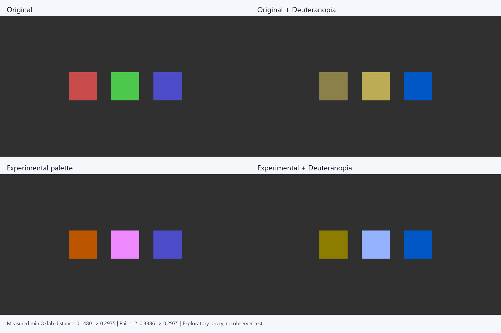
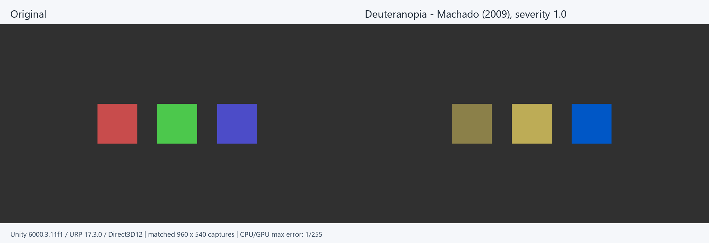
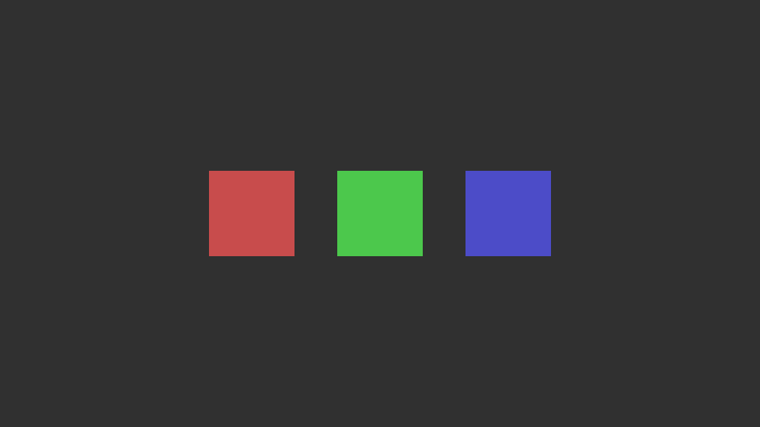

# ChromaAccess

Real-time color adaptation for players with color vision deficiencies.

A university project for **Image Content Analysis (ACI)**, developed incrementally in Unity. The research direction is to investigate recoloring for gameplay-relevant elements while measuring changes to visual appearance, temporal behavior, and GPU cost.

## Research direction

The planned comparison covers fixed global recoloring, recoloring adapted to scene colors, and a variant prioritizing important gameplay regions through annotated masks. Evaluation will consider object distinguishability, contrast under simulated deficiencies, temporal stability, and GPU processing time. Python and potentially OpenCV support later analysis; masks and general adaptive recoloring remain future work.

## Current status

- **Verified:** the controlled scene, identity pass, and Machado (2009) Deuteranopia, Protanopia, and approximate Tritanomaly modes at severity 1.0 on the PC renderer. Full-frame SDR comparisons passed within 1/255, including neutral, gamut and asymmetric probes. The two added modes matched their CPU references exactly in the tested 8-bit captures.
- **Current milestone:** Sprint 1 materials are prepared: the original/simulation comparison, initial protocol, focused literature review, and editable progress presentation. Rehearsal, presentation delivery, and supervisor feedback remain pending.
- **Available:** Editor controls for Original, Deuteranopia, Protanopia, and approximate Tritanomaly at fixed severity 1.0. All three modes passed their Unity GPU checks and cross-mode restoration tests in INT-011. The original/experimental palette comparison remains specific to deuteranopia.
- **Palette comparison package:** nine palettes, 48 raw Unity captures, ten separate four-view PNG layouts, an editable 18-slide PPT, and a local interactive comparator. See [the experiment study](docs/research/palette-lab.md) and INT-012.
- **Source limit:** Machado explicitly excludes tritanopia. The S-cone case is labeled Tritanomaly (approximation), including at severity 1.0. See the [three-mode study](docs/research/simulation-modes.md).
- **Planned:** reference recoloring, scene adaptation, object masks, temporal analysis, and GPU measurements. The optional tritanomaly extension does not automatically broaden the primary protanopia/deuteranopia research question.

The current patches are a debugging palette chosen for implementation checks. Their colors have not been selected or validated as perceptually matched confusion pairs.

Simulation approximates the effects of a color vision deficiency. Recoloring changes the image to try to improve differentiation. Evaluation investigates the benefits and tradeoffs, including comparisons under simulation. These are separate operations.

## Sprint 1 - Problem, literature, and simulation

**Working research question, proposed for discussion:** To what extent can real-time recoloring improve the distinguishability of gameplay-relevant elements under protanopia and deuteranopia simulations, while limiting changes to the image, temporal fluctuations, and GPU cost?

This question describes the project's research direction. Sprint 1 establishes the simulation and testing foundation; it does not yet answer the recoloring question or establish benefits for players.

| Sprint requirement | Current evidence | Remaining work |
| --- | --- | --- |
| Define the problem and research question | Working question, bounded Sprint 1 engineering question, and scope in the research review | Discuss the formulation and later evaluation criteria with the supervisor |
| Study simulation and relevant recoloring methods | Focused comparison of Brettel (1997), Machado (2009), and Machado/Oliveira (2010), with source-access limits | Study implementation choices for a published recoloring baseline before coding it |
| Choose the Unity configuration | Unity 6000.3.11f1, URP 17.3.0, PC renderer, Linear color space | Record any later configuration changes and revalidate |
| Build the test scene | ControlledColors with three unlit patches; temporary neutral and gamut probes verified and restored | Use this controlled baseline for later experiments |
| Implement and verify a first simulation | Deuteranopia at severity 1.0; CPU/GPU comparisons, preview switching, and identity regression passed | Revalidate when rendering conditions change and retain the stated test limitations |
| Prepare the idea, sources, and progress presentation | Editable 12-slide presentation, source-bearing notes, presenter guide, and frozen evidence snapshot | Rehearse, present, and record feedback |

**Target outcome:** a documented original/deuteranopia comparison of the same scene and an initial repeatable test protocol. Both are available; the [Sprint 1 test protocol](docs/testing/sprint-1-protocol.md) includes its first execution record. The [focused research review](docs/research/sprint-1-review.md), [progress presentation](docs/presentations/ChromaAccess_Sprint1.pptx), and [presenter guide](docs/presentations/sprint-1-presenter-guide.md) now supply the accompanying literature and presentation materials. Their [evidence snapshot](docs/presentations/sprint-1-evidence.json) preserves the reports and capture hashes used on 2026-10-19.

**Immediate next increment:** inspect the palette comparisons, select candidate source-drift and semantic-role constraints, then settle the published recoloring baseline and task evaluation criteria. General/published recoloring implementation, masks, temporal analysis, and GPU benchmarking remain later work.

## Palette comparison materials

- [Editable 18-slide comparison presentation](docs/presentations/ChromaAccess_Palette_Experiments.pptx), with source links and explanations in the notes.
- [Ten comparative PNG layouts](docs/images/palette-comparisons/) and [48 original Unity captures](docs/images/palette-lab-20261021/). The duplicate ZIP has been removed.
- [Local interactive comparator](docs/presentations/ChromaAccess_Palette_Compare.html), with two palette selectors, four inspection views, and available shape cues.
- [Methods and findings](docs/research/palette-lab.md), including ordinary selection procedures, deployed examples, and future project proposals.

Repeat capture with **Tools > ChromaAccess > Capture Palette Comparisons**. This renders cloned objects in an isolated preview scene and restores the simulation state. It does not save changes to ControlledColors. Player-facing palette presets, preference calibration, and general adaptive recoloring remain proposals.

## Open the current demo

1. Open this project with **Unity 6000.3.11f1**.
2. Open `Assets/Scenes/ControlledColors.unity`.
3. Select the **Game** view. The scene shows red, green, and blue squares from left to right on a dark gray background.
4. Open **Tools > ChromaAccess > Simulation Preview**. In Edit mode, click **Original**, **Original + Deuteranopia**, **Original + Protanopia**, or **Original + Tritanomaly (approximation)**. The two experimental palette buttons remain specific to deuteranopia.
5. Use **Tools > ChromaAccess > Capture Palette Comparisons** to regenerate the comparison captures. The Unity validation scripts and Validate buttons were removed in INT-013 at the user's request; existing reports remain as historical evidence.

The scene is static. Preview controls are for the Editor session, and the saved renderer starts in Original mode. Experimental colors use temporary per-object overrides; shared materials and saved scene colors remain intact. Closing the preview, reloading scripts, closing the scene, or leaving Edit mode clears the palette preview. No runtime/build interface has been added.

## Verified configuration

| Setting | Current value |
| --- | --- |
| Unity Editor | `6000.3.11f1`, revision `3000ef702840` |
| Creation template | Universal 3D / URP |
| Universal Render Pipeline | `17.3.0` |
| Project color space | Linear |
| Test scene | `Assets/Scenes/ControlledColors.unity` |
| Main Camera position | `(0, 0, -10)` |
| Main Camera rotation | `(0, 0, 0)` degrees |
| Projection | Orthographic, Size `5` |
| Background | Solid Color, `#303030`, fully opaque |
| Camera post-processing | Disabled |
| Patch geometry | Quad, scale `(2, 2, 1)`, rotation `(0, 0, 0)` |
| Patch shader | `Universal Render Pipeline/Unlit`, opaque |
| Full-screen feature | ChromaAccess Identity, PC renderer, enabled |
| Simulation feature | ChromaAccess Simulation, one selected material, same injection point, saved inactive |
| Simulation buffer settings | After Rendering Post Processing; Fetch Color Buffer on; Requirements None; Pass 0; depth-stencil binding off |

## Documentation workflow

Update this README alongside every substantive Unity project change. Group closely related actions into one intervention. Each entry must record:

1. **Intervention:** what changed and which files or settings were affected.
2. **Purpose:** the concrete problem or experiment the change supports.
3. **Motivation:** why this implementation was chosen.
4. **Sources:** original research or version-appropriate official documentation, stating what it supports.
5. **Verification and evidence:** checks actually performed, observed results, and links to available captures or measurements.
6. **Limitations:** what the evidence establishes and what remains unverified.
7. **Further study:** focused reading, concepts, or questions needed for the next step.

Keep the current status and next learning step consistent with the implementation. Record planned work separately from completed work. Repository documentation and code use English; mentoring explanations use Romanian. Add equations, coefficients, and method parameters only after checking their sources and explaining their meaning.

## Development journal

### INT-001 - Create the Unity URP project

**Date:** 2026-10-17. **Implementation:** assistant; initial editor operation confirmed by the user.

**Intervention:** Created the project at `D:\ChromaAccess` using Unity `6000.3.11f1` and its installed Universal 3D template. Unity resolved URP to `17.3.0`. The project contains `Assets`, `Packages`, and `ProjectSettings`.

**Purpose:** Establish a working rendering environment for the controlled demonstrator and later image transformations.

**Motivation:** The template configures URP and its assets together. URP provides documented insertion points for future full-screen effects.

**Sources:** [Create a new URP project][urp-template] supports the template choice. [Editor command-line arguments][editor-cli] documents `-createProject` and `-cloneFromTemplate`. [Full Screen Pass Renderer Feature][full-screen-pass] documents a possible future integration mechanism.

**Verification and evidence:** Initial batch-mode project creation completed with return code `0`. Checked `ProjectSettings/ProjectVersion.txt` and `Packages/manifest.json`. Opened the editor; the user confirmed successful startup.

**Limitations:** This establishes project startup and package configuration. No custom full-screen effect or GPU timing was measured. The template's default packages remain present.

**Further study:** How a URP Renderer, Renderer Feature, and render pass relate; injection points relative to other rendering operations.

### INT-002 - Configure the controlled camera and background

**Date:** 2026-10-17. **Implementation:** user following the guided steps; saved settings checked by the assistant.

**Intervention:** Saved `ControlledColors.unity`, moved it into `Assets/Scenes`, placed Main Camera at `(0, 0, -10)` with zero rotation, selected Orthographic projection with Size `5`, set an opaque `#303030` solid background, and disabled camera post-processing.

**Purpose:** Provide a simple, repeatable view for initial color comparisons.

**Motivation:** Orthographic projection keeps apparent object size independent of depth. Size `5` gives a vertical viewing span of `10` world units. A uniform background and disabled post-processing reduce variables in the initial setup.

**Sources:** [URP Camera Inspector reference][urp-camera] documents projection, background, and post-processing settings. [Camera.orthographicSize][orthographic-size] defines the visible vertical span.

**Verification and evidence:** Read the saved scene settings, including camera position and rotation, projection, size, background RGBA, and the disabled post-processing flag. Later Unity renders confirmed the background sample as `#303030FF`.

**Limitations:** A controlled static scene is an initial test environment. More complex lighting, materials, backgrounds, and camera motion remain future test conditions.

**Further study:** RGB versus sRGB encoding; linear color values; where Unity performs conversions between them.

### INT-003 - Create the first red patch

**Date:** 2026-10-17. **Implementation:** assistant.

**Intervention:** Created `Assets/Materials/PatchRed.mat` using URP Unlit, opaque, with Base Map color `#C84C4C`. Added a `PatchRed` Quad at the origin with scale `(2, 2, 1)` and assigned that material. Saved the scene. INT-004 later moved this patch to the left.

**Purpose:** Verify that a simple colored surface can be displayed and sampled before adding image-processing logic.

**Motivation:** Unlit avoids scene-light contributions to the patch color. A Quad provides a flat square in the local XY plane.

**Sources:** [URP Unlit material reference][urp-unlit] documents Base Map and opaque surfaces. [Primitive objects][primitives] describes Quad geometry. [URP camera render requests][render-requests] documents the API used to capture the verification image.

**Verification and evidence:** Created the assets through a temporary Unity Editor helper, saved them through Unity APIs, and removed the helper afterward. Rendered a `960 x 540` preview; the patch center was `#C84C4CFF` and a background sample was `#303030FF`. Inspected the rendered image and saved material assignment. No compilation errors were found during this operation. [Historical single-patch capture](docs/images/controlled-colors-single.png).

**Limitations:** These pixel samples verify the selected colors under this rendering configuration. They do not establish general color-pipeline correctness or accessibility benefits.

**Further study:** Material assets versus object instances; how material colors reach a shader in a Linear project.

### INT-004 - Add independent green and blue patches

**Date:** 2026-10-17. **Implementation:** assistant.

**Intervention:** Created `PatchGreen.mat` and `PatchBlue.mat` in `Assets/Materials`, added corresponding Quads, and arranged all three patches as follows:

| Object and material | Base Map color | World position |
| --- | --- | --- |
| `PatchRed` | `#C84C4C` | `(-3, 0, 0)` |
| `PatchGreen` | `#4CC84C` | `(0, 0, 0)` |
| `PatchBlue` | `#4C4CC8` | `(3, 0, 0)` |

All patches use zero rotation, scale `(2, 2, 1)`, opaque surfaces, and the same URP Unlit shader.

**Purpose:** Establish several input colors for future simulation and recoloring checks while holding geometry and material type constant.

**Motivation:** Independent material assets allow each patch color to be adjusted separately. Equal geometry avoids introducing shape or size differences into these initial color probes.

**Sources:** [Renderer.sharedMaterial][shared-material] explains how changing a shared material affects its users. The [URP Unlit reference][urp-unlit] defines the color and surface settings.

**Verification and evidence:** Checked that each object exists once, has the intended position and scale, and references its corresponding material GUID. The three material GUIDs are distinct. Rendered and visually inspected a `960 x 540` preview. No compilation errors were found during the operation. Removed the temporary Editor helper after saving.

**Limitations:** The patches have different luminance as well as different color. They are not a calibrated perceptual test or a measurement of gameplay performance. No simulation, recoloring, temporal metric, or GPU-cost result is claimed for this intervention.

**Further study:** Luminance versus chromatic differences; color-pair selection; neutral gray probes; why a numeric color difference alone does not establish accessibility.

### INT-005 - Add and validate the full-screen identity pass

**Date:** 2026-10-17. **Implementation:** assistant.

**Intervention:** Added `Assets/Shaders/FullScreenIdentity.shader` and `Assets/Materials/FullScreenIdentity.mat`. Added the active `ChromaAccess Identity` Full Screen Pass Renderer Feature to `Assets/Settings/PC_Renderer.asset`. Added `Assets/Editor/IdentityPassValidation.cs` and its Editor-only `IdentityPassControl.shader` so the check can be repeated from **Tools > ChromaAccess > Validate Identity Pass**. The installer used to configure these assets was temporary and was removed after setup.

**Purpose:** Establish a tested image-processing insertion point before implementing a color vision simulation.

**Motivation:** The built-in URP feature handles the color-buffer copy and full-screen draw. Its settings are **After Rendering Post Processing**, **Fetch Color Buffer enabled**, **Requirements = None**, **Pass = 0**, and **Bind Depth-Stencil disabled**. Fetch Color Buffer supplies the current camera color as `_BlitTexture`; the identity shader needs no extra depth, normal, or motion inputs. The effect uses the active PC renderer. The mobile renderer has not been configured for this feature.

**Operation:** `outputColor = inputColor`. The fragment function samples `_BlitTexture` at the current UV with the point-clamp sampler and returns all four channels. Unity's `Core.hlsl` and `Blit.hlsl` provide the full-screen vertex function and platform texture abstractions. There is no explicit sRGB decode or encode in this shader; input sampling and output handling use the configured Unity pipeline.

**Color-space note:** RGB names the channels, while their encoding determines what the numbers mean. sRGB is nonlinear; linear RGB channel values are proportional to channel light intensity. For example, decoding an sRGB channel value of `0.5` gives `((0.5 + 0.055) / 1.055)^2.4 = 0.214041...`. This is a standard conversion example, not a measured project result. Unity performs conversions according to its texture and render-target configuration, so additional manual conversions require checking that configuration first.

**Sources:** [Full Screen Pass Renderer Feature][full-screen-pass] supports the chosen injection point and buffer settings. [Unity's Linear workflow][linear-color] explains automatic conversions. [W3C sRGB conversion code][srgb-conversion] provides the transfer function used in the numerical example. The installed URP `17.3.0` sample `Samples~/URPRenderGraphSamples/BlitWithMaterial/BlitWithMaterial.shader` and Core RP `17.3.0` file `Runtime/Utilities/Blit.hlsl` were inspected for the HLSL entry points and sampling conventions. [URP render requests][render-requests] supports the capture method.

**Verification and evidence:**

- **Outcome:** True. Identity matched baseline at every RGBA8 pixel, including the asymmetric probe; execution control passed.
- **Environment:** Unity `6000.3.11f1`, URP `17.3.0`, `Direct3D12`, quality `PC`, `NVIDIA GeForce RTX 4070 Laptop GPU`, `Linear` color space.
- **Capture:** `960 x 540`, `sRGB ARGB32, 24-bit depth, single-sample target`. Comparisons include all RGBA8 channels at every pixel.
- **Live scene state:** `Assets/Scenes/ControlledColors.unity`; unsaved changes before capture: `True`; after validation: `True`. Existing unsaved edits were preserved; this run did not save or reload the scene.
- **Repeated baseline:** 0 differing pixels; maximum channel difference 0/255.
- **Identity versus baseline:** 0 differing pixels; maximum channel difference 0/255.
- **Asymmetric identity versus asymmetric baseline:** 0 differing pixels; maximum channel difference 0/255.
- **Execution control:** 518400 pixels changed; 518400 pixels were the expected opaque magenta.
- **Asymmetry exercised:** moving the red patch changed 17496 baseline pixels.
- **Sampled colors after identity:** red `C84C4CFF`, green `4CC84CFF`, blue `4C4CC8FF`, background `303030FF`.
- **Artifacts:** [JSON report](docs/validation/identity-pass.json), [before](docs/images/deuteranopia-original.png), [after](docs/images/deuteranopia-original.png), [execution control](docs/images/identity-control.png), [asymmetric before](docs/images/deuteranopia-asymmetric-original.png), and [asymmetric after](docs/images/deuteranopia-asymmetric-original.png).

The validation temporarily replaces the identity material with an Editor-only solid-magenta full-screen material. This positive control checks that the feature actually executes. It also temporarily moves the red patch upward by `1.5` world units, making the image asymmetric vertically; comparing this probe catches orientation errors that the original centered row could hide. The material, feature activation state, and patch position are restored afterward. The original scene geometry is retained.

**Limitations:** The evidence covers RGBA8 camera captures of this controlled scene at the recorded resolution, graphics API, and PC pipeline configuration. The camera's volume post-processing is disabled. The comparison does not establish HDR behavior, tone-mapping interactions, other quality levels, builds, other platforms, simulation accuracy, accessibility benefit, or GPU performance.

**Further study:** Color-buffer contents at different injection points; linear RGB versus display encoding; the assumptions and RGB transform in Machado, Oliveira, and Fernandes (2009); neutral-color preservation and out-of-gamut outputs. The simulation model and its coefficients remain pending source review.

### INT-006 - Verify the simulation source and calculate a deuteranopia reference

**Date:** 2026-10-19. **Implementation:** assistant; research and CPU calculation only.

**Intervention:** Added [source review and worked example](docs/research/machado-2009-deuteranopia.md), [CPU reference calculator](Tools/calculate_deuteranopia_reference.py), and [numerical report](docs/validation/deuteranopia-reference.json). Identified the supplied six-page PDF as the 2011 Machado and Oliveira overview, distinct from the 2009 simulation paper. Recorded the original tutorial's deuteranopia endpoint coefficients and the required color-space conversions. No Unity assets or rendering settings changed.

**Purpose:** Establish a traceable numerical target before implementing the first simulation shader.

**Motivation:** Start with one fixed case, deuteranopia at severity 1.0. Use the authors' precomputed 3 x 3 RGB matrix, applied to linear RGB as a column vector. An independent CPU calculation can later reveal matrix transposition, transfer-function, or clipping mistakes in the GPU implementation. The selected transform simulates color appearance; it does not perform recoloring.

**Sources:** Machado, Oliveira, and Fernandes (2009), DOI [10.1109/TVCG.2009.113](https://doi.org/10.1109/TVCG.2009.113), [corrected paper](https://www.inf.ufrgs.br/~oliveira/pubs_files/CVD_Simulation/Machado_Oliveira_Fernandes_CVD_Vis2009_final.pdf), Eqs. (8)-(11); [authors' tutorial, Table 1](https://www.inf.ufrgs.br/~oliveira/pubs_files/CVD_Simulation/CVD_Simulation.html#Tutorial), Deuteranomaly column, severity 1.0. [W3C transfer functions][srgb-conversion] support the sRGB decode/encode steps. The [official colorspace documentation](https://search.r-project.org/CRAN/refmans/colorspace/html/simulate_cvd.html) provides a software cross-reference for applying the model in linear RGB. Full provenance and the supplied PDF's bibliographic distinction appear in the source review.

**Verification and evidence:** Compared all nine calculator coefficients with values independently extracted from the original authors' HTML table. Executed the CPU calculator: sRGB `#C84C4C` decodes to linear `(0.577580440, 0.072271851, 0.072271851)`, transforms to `(0.257882812, 0.213801135, 0.066299175)`, and encodes/rounds to **`#8B7F49`**, with no clipping. Black preservation, neutral probes within `1.1e-6`, and all 256 sRGB channel round trips passed. The report records unrounded calculation values, source fingerprint, checks, and output policy. Verified that the saved scene and Unity asset/settings files were unchanged.

**Limitations:** This is a CPU numerical reference, not a rendered simulation result or perceptual validation. The six-decimal published matrix has row sums `(1.000000, 0.999999, 1.000001)`. SDR output clipping is an explicit project policy; the selected red example does not exercise it. Unity buffer encoding, alpha behavior, GPU precision, other colors, HDR, and accessibility outcomes remain to be checked during implementation.

**Further study:** Eq. (9) and neutral preservation; RGB channels versus cone responses; avoiding double sRGB decoding in Unity's Linear workflow; matrix orientation; output gamut; comparison of a separate simulation pass with this CPU reference.

### INT-007 - Align Sprint 1 scope and write the initial test protocol

**Date:** 2026-10-19. **Implementation:** assistant; planning and documentation only.

**Intervention:** Mapped the user's six Sprint 1 requirements to current evidence and remaining work in this README. Added a proposed working research question and [the initial test protocol](docs/testing/sprint-1-protocol.md).

**Purpose:** Define what must be demonstrated before Sprint 1 can be considered complete, with the original/simulation comparison as the next concrete result.

**Motivation:** Keep configuration checks, CPU calculations, GPU simulation results, literature review, and presentation readiness distinct. A test plan written before the simulation run makes expected results and acceptance conditions reviewable.

**Sources:** The user's Sprint 1 scope; project evidence in INT-005 and INT-006; the Machado (2009) original coefficients and W3C transfer functions documented in the [source review](docs/research/machado-2009-deuteranopia.md). Test cases and the initial SDR capture tolerance are project engineering choices, not published perceptual thresholds.

**Verification and evidence:** Checked the current README, shader and Editor file inventory, identity validation report, and CPU reference report. Verified the new documentation's local links and checked that the README retained the full existing development journal. No Unity simulation tests were executed in this documentation intervention.

**Limitations:** The research question is a working proposal. The new protocol is planned, not an execution report. Unity simulation, the literature comparison, and presentation preparation remain outstanding.

**Further study:** Relevant recoloring methods and baselines; measurable color differentiation versus player task performance; simulation implementation precision; explicit failure reporting and repeatable capture conditions.

### INT-008 - Implement and verify the first deuteranopia simulation

**Date:** 2026-10-19. **Implementation:** assistant. **Status:** GPU verification passed.

**Intervention:** Added `Assets/Shaders/Deuteranopia.shader`, `Assets/Materials/Deuteranopia.mat`, an independent PC full-screen feature, `Assets/Editor/SimulationPreview.cs`, and `Assets/Editor/DeuteranopiaValidation.cs`. Updated identity validation to isolate the simulation and restore its activation state. Extended the Python CPU reference to nine probes. Saved raw paired captures, a labeled comparison figure, and the GPU validation report. Removed the temporary installer after configuring and verifying the renderer, including its serialized feature map.

**Purpose:** Produce the first original/deuteranopia comparison and verify it against independent CPU calculations.

**Motivation:** Use the fixed Machado severity-1.0 matrix directly on linear samples, preserve source alpha, and explicitly clamp output RGB to [0, 1] for this SDR experiment. Keep identity and simulation as distinct effects. A small Editor preview exposes Original and Deuteranopia modes without changing the saved scene.

**Sources:** The [source review](docs/research/machado-2009-deuteranopia.md) records the original Machado (2009) table and transfer functions. [Full Screen Pass Renderer Feature][full-screen-pass] and the installed URP 17.3.0 implementation support the injection and buffer-copy configuration. [URP render requests][render-requests] support the capture method. [RenderTextureReadWrite](https://docs.unity3d.com/6000.3/Documentation/ScriptReference/RenderTextureReadWrite.html) documents target encoding.

**Verification and evidence:**

- Unity `6000.3.11f1`, URP `17.3.0`, `Direct3D12`, `NVIDIA GeForce RTX 4070 Laptop GPU`, PC quality, Linear color space. GPU validation exited with code 0. After finalizing renderer serialization, reopened the project and repeated validation; it passed again. Latest report timestamp: `2026-10-19T15:48:08.4785743Z`.
- The shader and C# CPU matrix match all nine entries independently extracted from the authors' table. The independent Python calculator agrees with all nine C# sample expectations and observed outputs within 1/255.
- Full `960 x 540` SDR RGBA8 comparisons: maximum RGB error **1/255** for the scene, gamut probes, and asymmetric probe; **0/255** for neutral probes. No pixels exceeded the predeclared tolerance; no alpha mismatches occurred.
- In the main comparison, 11664 pixels differed from the ideal CPU reference by at most one code value; 34992 pixels changed relative to the original scene. Red center: CPU `#8B7F49`, GPU `#8B8049`. Green and blue centers matched exactly. These results are not bit-identical for every color.
- A separate linear floating-point diagnostic through the identity material at the simulation injection point measured red input `(0.577580512, 0.072271861, 0.072271861)`; maximum difference from decoded input was approximately `7.12e-8`. The tested shader needs no manual sRGB decode or encode.
- Identity regression, exact repeated baseline, exact original restoration, mode activation switching, and restoration of temporary scene/effect state passed. The saved scene, patch materials, pipeline asset, mobile renderer, Packages and ProjectSettings were unchanged. Unsaved scene changes before/after validation: false/false.
- Evidence: [GPU report](docs/validation/deuteranopia-pass.json), [CPU report](docs/validation/deuteranopia-reference.json), [original](docs/images/deuteranopia-original.png), [simulated](docs/images/deuteranopia-simulated.png), [comparison](docs/images/deuteranopia-comparison.png), and [protocol/execution record](docs/testing/sprint-1-protocol.md). The comparison figure was assembled from the raw captures without changing their pixel colors.

**Limitations:** Evidence covers the recorded PC/Linear/SDR captures and opaque scene. Existing camera/pipeline settings are HDR-capable, but these tests do not establish HDR output or tone-mapping behavior. The floating-point diagnostic uses a different target format from the SDR comparison. The exact stage responsible for one-code-value differences was not isolated. No transparent-content test, runtime UI, standalone-build test, recoloring, accessibility outcome, or GPU-cost result is claimed.

**Further study:** Internal color-buffer precision and final encoding/quantization; neutral preservation versus chromatic discrimination; relevant recoloring baselines and temporal assumptions; evaluation cases beyond this debugging palette.

### INT-009 - Explore a constrained three-color palette

**Date:** 2026-10-19. **Implementation:** assistant. **Status:** four-case Unity experiment verified.

**Intervention:** Added `Tools/search_experimental_palette.py`, `Assets/Settings/ExperimentalPalette.json`, `Assets/Editor/ExperimentalPalettePreview.cs`, and `Assets/Editor/PaletteExperimentValidation.cs`. Extended the Editor window to show Original, Original + Deuteranopia, Experimental palette, and Experimental + Deuteranopia. Isolated existing validators from active palette overrides and restored preview state afterward. Added four matched captures, reports, a comparison figure, and the study note. Removed the temporary run-once helper after execution.

**Purpose:** Test whether another three-color palette can increase the minimum pairwise separation under the verified simulation while keeping source relative luminance close to the original.

**Motivation:** Keep the third patch fixed. Search alternatives for the first two on a finite sRGB grid, constrained to source relative-luminance changes no greater than 0.01. Maximize the smallest post-simulation Oklab pair distance; break ties by original-color drift. This is an exploratory project baseline, not an implementation of Machado and Oliveira's 2010 recoloring algorithm.

**Sources:** Machado (2009) supplies simulation only. [Bjorn Ottosson's Oklab definition](https://bottosson.github.io/posts/oklab/) supplies the coordinate transform; [W3C deltaEOK](https://www.w3.org/TR/css-color-4/#color-difference-OK) supplies Euclidean distance. [W3C relative luminance](https://www.w3.org/TR/WCAG22/#dfn-relative-luminance) supplies the source Y formula. [Unity MaterialPropertyBlock.SetColor](https://docs.unity3d.com/6000.3/Documentation/ScriptReference/MaterialPropertyBlock.SetColor.html) supports per-object temporary overrides and sRGB-to-linear handling. [Study note](docs/research/experimental-palette.md) records equations, selection choices, and limitations.

**Verification and evidence:**

- CPU search: 172 candidates for the first object and 82 for the second, or 14104 palettes. Selected `#BB5500`, `#EE88FF`, `#4C4CC8`. Continuous CPU minimum post-simulation Oklab distance: 0.148905 -> 0.297682. [Search report](docs/validation/palette-search.json).
- Captured all four cases in the already-open Unity Editor, using PC/Linear/Direct3D12 and the RTX 4070 Laptop GPU at `960 x 540`. Observed minimum distance on 8-bit simulated captures: **0.147982 -> 0.297495**. These observed values differ slightly from the continuous CPU search values because they are computed from captured display values.
- All three observed pair distances (original -> experimental): 0-1 `0.147982 -> 0.297796`; 0-2 `0.283336 -> 0.319059`; 1-2 `0.388643 -> 0.297495`. One pair becomes less separated.
- Original-to-experimental Oklab source drift: approximately `(0.071201, 0.392320, 0)`. Source relative-Y changes: `(-0.009083, -0.003614, 0)`, within the chosen absolute bound of 0.01. No observer-brightness equivalence is inferred.
- Full-frame CPU/GPU simulation checks: original palette max error 1/255; experimental palette max error 0/255; 0 pixels outside tolerance and 0 alpha mismatches. Palette application affected only the expected object colors. Exact original restoration passed.
- Existing simulation and identity regressions passed while the experimental preview was active. The preview and effect activation state were restored afterward. No scene saving/reloading was required; the run had no unsaved scene changes before or afterward. Saved scene, materials, renderer assets, Packages and ProjectSettings remained unchanged.
- Independently recalculated all six captured pair distances in Python and matched the C# results within `1e-12`. Oklab black and white reference checks passed. Visually inspected the four-case figure and verified that its panels retain the raw capture pixels.
- Evidence: [Unity report](docs/validation/palette-experiment.json), [four-case figure](docs/images/palette-comparison.png), [study note](docs/research/experimental-palette.md), and the four raw images linked there. The report records the run timestamp and actual source/simulated sample colors.

**Limitations:** The middle patch changes strongly from green to pink, and one pair loses separation even though the minimum improves. This optimum applies only to the finite grid and constraints. Oklab distance on simulated colors is an exploratory proxy, not a calibrated discrimination threshold for people with deuteranopia. No restoration of trichromatic vision, published recoloring baseline, temporal adaptation, or gameplay benefit is established.

**Further study:** Inspect the four captured cases, all three pair distances, source-color drift, and relative-luminance changes. Study semantic color constraints and published recoloring objectives before extending this experiment.

### INT-010 - Prepare the Sprint 1 research and presentation materials

**Date:** 2026-10-19. **Implementation:** assistant, following the user's approval to prepare the Sprint 1 materials.

**Intervention:** Added a focused [research review](docs/research/sprint-1-review.md), an editable [12-slide progress presentation](docs/presentations/ChromaAccess_Sprint1.pptx), a [presenter guide](docs/presentations/sprint-1-presenter-guide.md), and an [evidence snapshot](docs/presentations/sprint-1-evidence.json). Updated the Sprint 1 status and reading queue. No Unity scene, shader, renderer, or package changes form part of this intervention.

**Purpose:** Make the problem, research question, source choices, original/simulation comparison, and initial test protocol concrete and reviewable for the Sprint 1 presentation.

**Motivation:** Separate the broader recoloring question from the narrower implementation check completed so far. Explain the palette experiment as an optional numerical tradeoff, with all pair distances and semantic-color costs. Preserve the actual evidence behind the presentation when later validation runs replace live reports.

**Sources:** [Brettel, Viénot, and Mollon (1997)](https://vision.psychol.cam.ac.uk/jdmollon/papers/Dichromat_simulation.pdf) supports the alternative LMS simulation comparison. [Machado et al. (2009)](https://www.inf.ufrgs.br/~oliveira/pubs_files/CVD_Simulation/Machado_Oliveira_Fernandes_CVD_Vis2009_final.pdf) and the [author matrices](https://www.inf.ufrgs.br/~oliveira/pubs_files/CVD_Simulation/CVD_Simulation.html#Tutorial) support the selected first simulation. The [2010 journal record](https://diglib.eg.org/items/e649eef3-7f82-4338-a92d-b9f5fb7fd9bc) and [Machado's 2010 thesis, Chapter 5](https://www.inf.ufrgs.br/~oliveira/students_dissertations/Masters/Gustavo_Machado_Masters_thesis_UFRGS_2010.pdf) support the recoloring-method study. The separate full 2010 journal PDF was not read. XAG 103 supplies accessibility context; Oklab and W3C definitions support the optional palette calculations. Full links and source roles appear in the review and slide notes.

**Verification and evidence:** The presentation uses the successful reports from 2026-10-19 around 16:28:37 UTC and four matched raw Unity captures. The snapshot records SHA-256 hashes and preserves report contents. Numerical statements were checked against these frozen inputs. The finalized 12-slide package passed structural and geometry checks and re-imported successfully. All 12 final slides were rendered and individually inspected for text fit, source/capture placement, and table readability. Tables remain editable. The presentation has not been opened in Microsoft PowerPoint. Unity was not rerun to prepare the materials.

**Limitations:** The working research question still needs feedback. Presentation delivery and rehearsal remain pending. The review covers selected methods rather than a systematic literature search. CPU/GPU agreement establishes tested implementation behavior, not universal perceptual fidelity or player benefit. The published recoloring method, protanopia, temporal behavior, GPU timing, and participant testing remain unimplemented or unmeasured.

**Further study:** Study the 2010 method's contrast-loss direction, projection/rotation, temporal sign rule, and failure example. Define acceptable semantic-color changes and baseline acceptance criteria before further implementation. Rehearse the original/simulation demo and record supervisor feedback.

### INT-011 - Add protanopia and approximate tritanomaly

**Date:** 2026-10-21. **Implementation:** assistant, following the user's request for two additional simulation cases.

**Intervention:** Added Protanopia and Tritanomaly shaders/materials, explicit simulation selection, a shared three-mode numerical validator, a mode/restoration suite, an independent Python reference tool, a primary-source coefficient record, and a [study/protocol note](docs/research/simulation-modes.md). Renamed the existing renderer feature to ChromaAccess Simulation and reused its single material slot. Updated palette validation to restore the exact prior simulation material as well as activation flags. Existing deuteranopia APIs and palette controls remain available.

**Purpose:** Compare the same controlled scene under two additional source-defined CVD cases and make the cases selectable in the Editor.

**Motivation:** Reuse the verified Linear RGB pass, fixed severity 1.0, SDR clipping, and 1/255 acceptance criterion. One simulation pass prevents accidental stacking. The original paper explicitly excludes tritanopia, so the S-cone mode uses its correct Tritanomaly (approximation) label. The palette experiment remains optimized for deuteranopia only.

**Sources:** [Machado et al. (2009), corrected paper](https://www.inf.ufrgs.br/~oliveira/pubs_files/CVD_Simulation/Machado_Oliveira_Fernandes_CVD_Vis2009_final.pdf), sections 4.2.1 and 4.3, supplies the tritan limitation. The [author's Table 1](https://www.inf.ufrgs.br/~oliveira/pubs_files/CVD_Simulation/CVD_Simulation.html#Tutorial), severity 1.0, supplies the three matrices. The primary HTML downloaded on 2026-10-19 was used after fresh author-page requests timed out; the [coefficient record](docs/research/machado-2009-matrices.json) retains its SHA-256. [Unity Full Screen Pass](https://docs.unity3d.com/6000.3/Documentation/Manual/urp/renderer-features/renderer-feature-full-screen-pass.html) supports the rendering integration. [W3C conversion functions](https://www.w3.org/TR/css-color-4/#color-conversion-code) support sRGB transfer handling.

**Verification and evidence:**

- Unity 6000.3.11f1 compiled the scripts and required shaders, then completed the graphics-enabled batch suite with exit code 0 on 2026-10-21, approximately 15:35:27-15:35:32 UTC. Conditions: URP 17.3.0, PC/Linear, Direct3D12, NVIDIA GeForce RTX 4070 Laptop GPU, 960 x 540 sRGB ARGB32 captures.
- Protanopia and approximate Tritanomaly each matched the CPU reference exactly at every RGB8 pixel in the original scene, neutral probes, saturated gamut probes, and asymmetric scene: maximum error 0/255. Deuteranopia regression retained maximum error 1/255, within the existing criterion. All comparisons had zero pixels outside tolerance and zero alpha mismatches.
- Independent Python/NumPy float64 recomputation passed all twelve full-frame image-pair comparisons and all 27 reported sample cases. Black, rounded neutral-row preservation, and all 256 sRGB channel round-trip checks passed. The original deuteranopia reference file/schema was retained; the new tool also writes a separate deuteranopia-matrix reference.
- Each validator ran over a different active simulation plus experimental palette, then restored the prior image exactly. The existing deuteranopia palette regression also restored an active tritanomaly view exactly. Original and the three simulated modes produced distinct captures, with exclusive effect selection. The suite restored its initial material and activation state.
- Visually inspected both added simulated captures. Saved ControlledColors, original materials, Packages, and ProjectSettings matched the pre-change hashes. Existing intervention entries INT-001 through INT-010 remain unchanged. No unsaved scene changes existed before or after the suite.
- Reports: [Protanopia](docs/validation/protanopia-pass.json), [Tritanomaly](docs/validation/tritanomaly-pass.json), [Deuteranopia](docs/validation/deuteranopia-pass.json), [mode/restoration suite](docs/validation/simulation-suite.json), and [independent pixel checks](docs/validation/simulation-independent-check.json). Captures: [Protanopia](docs/images/protanopia-simulated.png), [Tritanomaly](docs/images/tritanomaly-simulated.png). The [study note](docs/research/simulation-modes.md) contains the controls, protocol, coefficients, source limits, and sample values.

**Limitations:** Tritanomaly approximates altered S-cone responses and does not model tritanopia. Current targets are controlled opaque patches and PC/Linear SDR. No participant study, HDR result, GPU timing, or new recoloring result is established. The Sprint 1 deck and frozen evidence remain the historical 2026-10-19 snapshot.

**Further study:** Contrast absent and altered cone responses; study clipping and observer variability. Review a suitable separate model before attempting true tritanopia simulation. Return to the published recoloring baseline and semantic-color constraints after these added simulation checks.

### INT-012 - Capture comparative palette experiments

**Date:** 2026-10-21. **Implementation:** assistant, following the user's request for comparative captures, palette experiments, and presentation explanations.

**Intervention:** Added a reproducible nine-palette search/configuration and an Editor capture menu. The capture tool clones the controlled camera and three objects into an isolated preview scene, uses a tighter identical framing, and captures Original plus all three simulation modes. Three palette cases also include distinct white shape cues. Added an editable 18-slide comparison deck, ten comparative PNG exports, a self-contained interactive HTML viewer, an image/data archive, and a methods/findings note. The historical Sprint 1 deck remains separate.

**Purpose:** Compare curated, manually chosen, and numerically searched palettes, including their effects on an unfiltered view and multiple simulated deficiencies. Illustrate redundant shape coding and explain the distinction between simulation and player-facing adaptation.

**Motivation:** A profile optimized for one simulation can lose separation elsewhere. Compare per-mode searches with an objective over all four views and a variant bounding original-color drift. Preserve full raw Unity captures and record the selection constraints. Geometry cues demonstrate a communication channel beyond hue.

**Sources:** [Machado (2009) coefficients](https://www.inf.ufrgs.br/~oliveira/pubs_files/CVD_Simulation/CVD_Simulation.html#Tutorial) supply simulation. [Okabe and Ito](https://jfly.uni-koeln.de/color/) supply the curated palette reference and redundant-coding guidance. [XAG 103](https://learn.microsoft.com/en-us/xbox/accessibility/xbox-accessibility-guidelines/103) supplies configurable colors and supplemental cues. [W3C use of color](https://www.w3.org/WAI/WCAG22/Understanding/use-of-color.html) supports additional visible signifiers. [Oklab](https://bottosson.github.io/posts/oklab/) and [W3C deltaEOK](https://www.w3.org/TR/css-color-4/#color-difference-OK) define the exploratory metric. The existing thesis review supports the discussion of published recoloring separately from this project's search.

**Verification and evidence:**

- Captured 48 actual Unity frames at 1440 x 540: nine palettes in four inspection views, plus Original, Matched-Y, and Balanced cases with shape cues in four views. Used Unity 6000.3.11f1, URP 17.3.0, PC/Linear, Direct3D12, and the RTX 4070 Laptop GPU. The cloned camera used orthographic size 2 for presentation framing; the saved camera remains size 5.
- Independent NumPy float64 recomputation passed all 36 simulated full-frame comparisons: maximum RGB error 1/255, zero pixels outside the pre-existing tolerance, and zero alpha mismatches. All unfiltered source samples matched the configured palette values. Captured eight-bit scores are recorded separately from continuous CPU search scores.
- The balanced search had the greatest captured worst-view minimum among the nine cases, approximately 0.2701 versus 0.1480 for the original. Bounding each source Oklab drift to 0.15 reduced maximum drift to about 0.1494 and the worst-view minimum to about 0.2039. These are numerical tradeoffs, not participant outcomes.
- Renderer material and activation states restored exactly, source scene dirtiness stayed false, and all pre-existing files under Assets, Packages, and ProjectSettings matched their pre-experiment hashes. The preview scene closed after capture. Original scene and material files remain intact.
- Finalized and re-imported the 18-slide PPTX. It contains five native editable tables and embedded original capture bytes. Rendered and inspected every slide; reviewed the native-table layout warning on slide 12 against its rendered result. No overlap was visible. Microsoft PowerPoint itself was not opened.
- Tested the offline viewer in headless Edge: all 36 palette/view combinations loaded 1440 x 540 images, and shape-cue controls, all-view display, and A/B swapping passed without page errors. Visually inspected the default and shape-cue views. The ZIP passed integrity checks and contains 48 raw images and ten comparative image exports, plus the presentation and explanatory data.
- Evidence: [Unity capture report](docs/validation/palette-lab-captures.json), [independent analysis and image hashes](docs/validation/palette-lab-analysis.json), [study note](docs/research/palette-lab.md), and the three presentation/comparison deliverables linked above.

**Limitations:** Simulated Oklab distance is a screening proxy, not a participant discrimination threshold. No universal palette, clinical calibration, player benefit, or new published recoloring implementation is established. The S-cone case remains approximate Tritanomaly, not Tritanopia. New player-facing presets and adaptive/semantic behaviors are proposals unless explicitly demonstrated.

**Further study:** Compare all pair distances and original-color drift, then define task-specific color roles and collect participant feedback. Study semantic masks, personal adjustment, and temporal stability before real-time adaptation.

### INT-013 - Remove Unity validators and prepare the Stage 1 repository

**Date:** 2026-10-21. **Implementation:** assistant, following the user's request to remove Unity tests, clean redundant files, and publish Stage 1 to GitHub.

**Intervention:** Removed the four Unity validation classes, their metadata, and the validation-only control shader. Removed Validate buttons and their legacy boolean adapter from the preview. Kept the simulation shaders, three-mode preview, experimental palette, and palette comparison capture tool. Removed the template tutorial/Readme, unused SampleScene, duplicate ZIP bundle, byte-identical capture copies, and generated IDE project files. Configured ControlledColors as the build scene. Added Unity-specific Git ignore rules and text attributes. The comparison PNGs and CSV were extracted before removing the duplicate archive; the HTML viewer now references the original PNGs.

**Purpose:** Publish a clean Stage 1 Unity project with the working demonstrator and research/presentation material, without the project's in-Editor automated test tools or duplicated distribution files.

**Motivation:** Keep source assets and useful evidence under version control. Exclude Unity caches, logs, local settings, and IDE-generated files. Preserve the remote repository's existing history and the original research direction. Preserve historical measurements without presenting removed menu commands as current instructions.

**Sources:** Existing shader/renderer references and intervention records support the retained simulation. The installed Unity package manifests establish that some test-related packages remain indirect dependencies of standard Unity packages; only the explicit root test-framework dependency was removed. No third-party package dependency was manually broken.

**Verification and evidence:** Unity 6000.3.11f1 completed a compile-only batch import with exit code 0 and no reported C# or shader compilation errors; no Unity test suite was run. Edge loaded all 36 palette/view combinations, shape controls, all-view display, and swap controls without page errors. All 116 local Markdown links resolved. Eighteen deleted image copies were confirmed byte-identical to their retained aliases; an independent recalculation of the 12 historical full-frame comparisons still stayed within 1/255. The ControlledColors scene hash remained unchanged, and no retained asset referenced a removed asset GUID. Unity regenerated the package lock with test-framework as an indirect dependency at depth 1. Prepublication review excludes caches, logs, local settings, and generated IDE files. The requested commit uses a Signed-off-by trailer and the title `[ChromaAccess]: Etapa 1`, with a short body on a separate paragraph.

**Limitations:** Historical test results remain evidence of earlier runs, not executable Unity tests in the cleaned project. General recoloring, participant benefit, temporal stability, and GPU measurements remain future work. The S-cone mode remains approximate tritanomaly rather than tritanopia.

**Further study:** Select the published recoloring baseline, define semantic-color constraints, and evaluate candidate palettes with suitable gameplay tasks.

## Historical validation evidence

The exploratory palette increases the minimum Oklab distance measured on simulated captures from about 0.1480 to 0.2975. The original green object becomes pink before simulation; one pair distance decreases. This is a numerical tradeoff demonstration, not proof of improved player performance or restored color vision. See INT-009 and the [experiment report](docs/validation/palette-experiment.json).

The first verified simulation uses Machado (2009), deuteranopia severity 1.0. Both panels are Unity captures of the same scene/camera. RGB error stayed within 1/255 of the CPU reference; this is an implementation check, not an accessibility result.

| Patch | Original RGB | CPU expected RGB | Unity observed RGB |
| --- | --- | --- | --- |
| Red | `#C84C4C` | `#8B7F49` | `#8B8049` |
| Green | `#4CC84C` | `#BDAC56` | `#BDAC56` |
| Blue | `#4C4CC8` | `#0057C6` | `#0057C6` |

Raw simulation captures and the JSON report below record the earlier validation run; the Unity validator was removed in INT-013. The labeled figure records the INT-008 run; regenerate it when replacing that evidence. The identity image and samples below describe the original-scene regression baseline.

The capture was produced in Unity using a URP `SingleCameraRequest`, an sRGB ARGB32 render target at `960 x 540`, and PNG readback. These are development checks, not performance benchmarks.

| Sample | Pixel coordinate, origin bottom-left | Expected RGBA hex | Observed RGBA hex |
| --- | --- | --- | --- |
| Red patch center | `(318, 270)` | `C84C4CFF` | `C84C4CFF` |
| Green patch center | `(480, 270)` | `4CC84CFF` | `4CC84CFF` |
| Blue patch center | `(642, 270)` | `4C4CC8FF` | `4C4CC8FF` |
| Background | `(10, 10)` | `303030FF` | `303030FF` |

These sample values were recorded during INT-004 and rechecked after the identity pass in INT-005. Re-capture them when relevant rendering settings change.

## Next learning step

Rehearse the [Sprint 1 presentation](docs/presentations/ChromaAccess_Sprint1.pptx) using the [presenter guide](docs/presentations/sprint-1-presenter-guide.md), then discuss the working research question and semantic-color constraints. Use the [focused review](docs/research/sprint-1-review.md) to settle a published recoloring baseline and its acceptance criteria before extending the implementation. Explain all pair distances and source-color drift alongside the experimental minimum-distance gain. General recoloring remains planned; the current prototype is a fixed object-specific palette. See [the palette study](docs/research/experimental-palette.md), [simulation source walkthrough](docs/research/machado-2009-deuteranopia.md), and [simulation protocol](docs/testing/sprint-1-protocol.md).

The earlier identity and simulation reports are retained as historical evidence. Their Unity validation scripts and menu actions were removed in INT-013. Use the preview for interactive inspection and the capture menu for presentation images.

## Research reading queue

The [focused review](docs/research/sprint-1-review.md) compares the sources below and records what each supports. The first simulation source has been implemented for one fixed deuteranopia case. The recoloring source remains a candidate for further study; its algorithm has not been implemented.

1. **Gustavo M. Machado, Manuel M. Oliveira, and Leandro A. F. Fernandes (2009).** *A Physiologically-based Model for Simulation of Color Vision Deficiency*. IEEE Transactions on Visualization and Computer Graphics, 15(6), 1291-1298. [DOI](https://doi.org/10.1109/TVCG.2009.113). [Corrected paper hosted by a co-author](https://profs.ic.uff.br/~laffernandes/content/publications/journal/2009_tvcg_15%286%29/machado_oliveira_fernandes-tvcg-15%286%29-2009-corrected.pdf). [Original tutorial and coefficients](https://www.inf.ufrgs.br/~oliveira/pubs_files/CVD_Simulation/CVD_Simulation.html#Tutorial). **Reviewed so far:** the RGB transform, deuteranopia endpoint coefficients, and a linear RGB CPU example (INT-006). **Next study:** integration precision and validation limits. **Implemented use:** the first Unity simulation, deuteranopia at severity 1.0 (INT-008).
2. **Hans Brettel, Françoise Viénot, and John D. Mollon (1997).** *Computerized simulation of color appearance for dichromats*. JOSA A, 14(10), 2647-2655. [DOI](https://doi.org/10.1364/JOSAA.14.002647). [Author-hosted paper](https://vision.psychol.cam.ac.uk/jdmollon/papers/Dichromat_simulation.pdf). **Reviewed:** LMS projection geometry, calibration/gamut requirements, and limits of observer evidence. **Potential use:** later cross-model comparison; not implemented.
3. **Gustavo M. Machado and Manuel M. Oliveira (2010).** *Real-Time Temporal-Coherent Color Contrast Enhancement for Dichromats*. Computer Graphics Forum, 29(3), 933-942. [DOI](https://doi.org/10.1111/j.1467-8659.2009.01701.x). [Publisher record](https://diglib.eg.org/items/e649eef3-7f82-4338-a92d-b9f5fb7fd9bc). **Reviewed:** journal record and abstract, with detailed algorithm study through [Machado's 2010 master's thesis, Chapter 5](https://www.inf.ufrgs.br/~oliveira/students_dissertations/Masters/Gustavo_Machado_Masters_thesis_UFRGS_2010.pdf), printed pages 55-65. The separate full journal PDF was not read. **Next study:** implementation choices, contrast-loss direction, temporal sign handling, and failure cases. **Potential use:** published recoloring baseline; not implemented.
4. **Microsoft (2026 revision).** *Xbox Accessibility Guideline 103: Additional channels for visual and audio cues*. [Guideline](https://learn.microsoft.com/en-us/xbox/accessibility/xbox-accessibility-guidelines/103), updated 2026-03-04. **Study focus:** supplemental cues beyond color and the distinction between simulation checks and testing with players. **Potential use:** accessibility context and evaluation limitations.

Unity documentation below targets **Unity 6.3 / 6000.3**. Sources were consulted during setup on 2026-10-17 and simulation integration on 2026-10-19. Published findings remain separate from project measurements.

[urp-template]: https://docs.unity3d.com/6000.3/Documentation/Manual/urp/creating-a-new-project-with-urp.html
[editor-cli]: https://docs.unity3d.com/6000.3/Documentation/Manual/EditorCommandLineArguments.html
[full-screen-pass]: https://docs.unity3d.com/6000.3/Documentation/Manual/urp/renderer-features/renderer-feature-full-screen-pass.html
[urp-camera]: https://docs.unity3d.com/6000.3/Documentation/Manual/urp/camera-component-reference.html
[orthographic-size]: https://docs.unity3d.com/6000.3/Documentation/ScriptReference/Camera-orthographicSize.html
[urp-unlit]: https://docs.unity3d.com/6000.3/Documentation/Manual/urp/unlit-shader.html
[primitives]: https://docs.unity3d.com/6000.3/Documentation/Manual/PrimitiveObjects.html
[render-requests]: https://docs.unity3d.com/6000.3/Documentation/Manual/urp/User-Render-Requests.html
[shared-material]: https://docs.unity3d.com/6000.3/Documentation/ScriptReference/Renderer-sharedMaterial.html
[linear-color]: https://docs.unity.com/en-us/engine/6000.3/manual/materials-and-shaders/graphics-color/color-spaces/linear-color-space/space
[srgb-conversion]: https://www.w3.org/TR/css-color-4/#color-conversion-code
